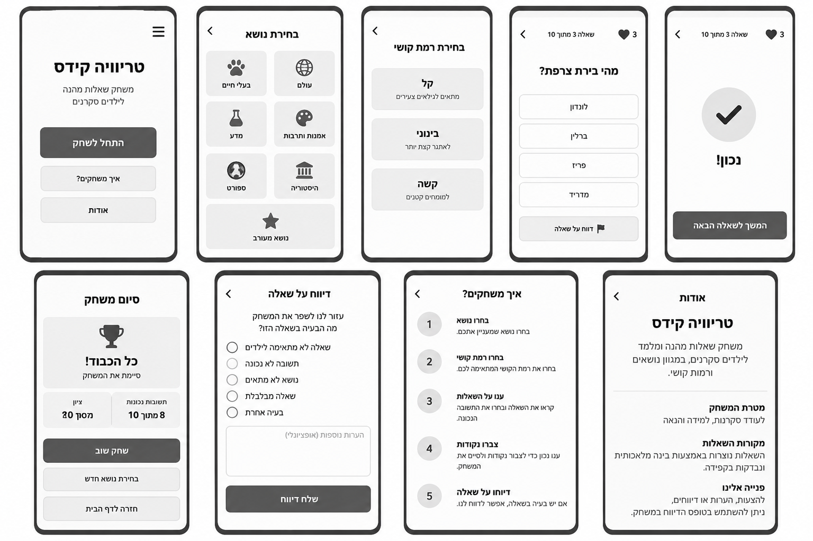
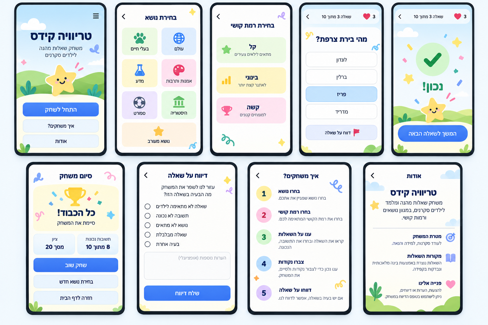
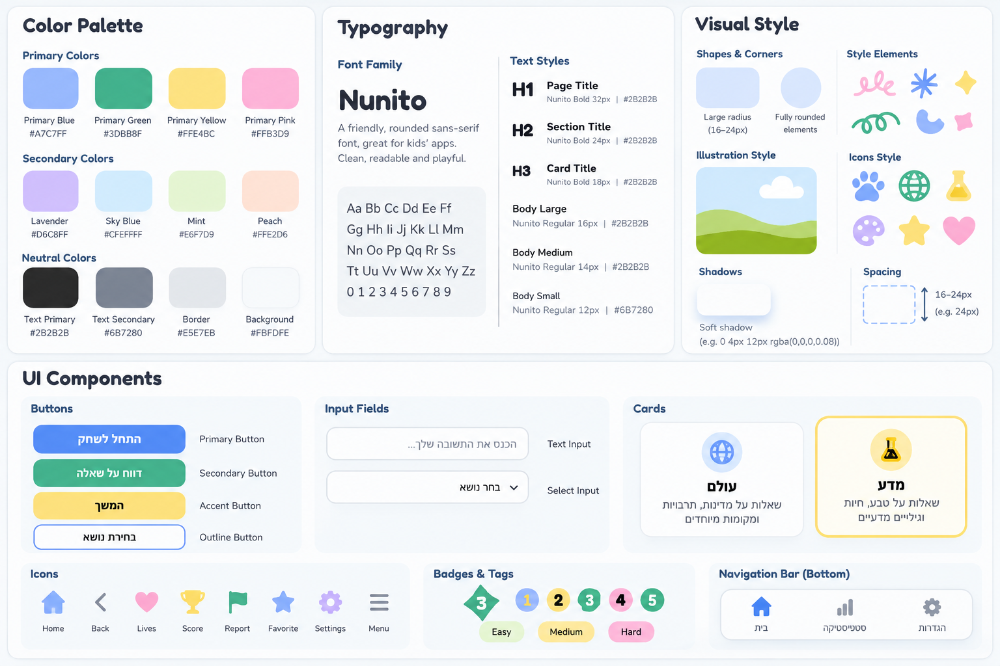

# DESIGN — טריוויה קידס

מסמך עיצוב למימוש ממשק המשתמש, על בסיס ה־PRD, ה־Wireframes, ה־Style Guide וה־Mockups. שפת ברירת המחדל בדוגמאות היא עברית (RTL). תמונות הייחוס מציגות לעיתים תצוגות או רכיבים שאינם תואמים במדויק את ה־PRD; במקרים אלה **ה־PRD הוא מקור האמת לפונקציונליות**, וה־Wireframes וה־Mockups משמשים השראה למבנה ולמראה בלבד.

## 1. Screens — מסכי האפליקציה

### 1.1 בית

- **מטרה:** הצגת האפליקציה והתחלת משחק חדש או חזרה למשחק קיים.
- **מבנה ותוכן:** כותרת בולטת "טריוויה קידס", תיאור קצר, אזור איור ידידותי, בחירת שפה וקבוצת גיל וכפתור התחלת משחק. במשחק שמור, הפעולות הרלוונטיות הן "המשך משחק" ו"משחק חדש".
- **פעולות וניווט:** בחירת שפה וקבוצת גיל, מעבר למשחק, חזרה למשחק שמור ומעבר ל"אודות". התחלת משחק חדש כשקיים משחק פעיל מחייבת אישור.
- **הערת התאמה:** בחירת שפה וגיל מחויבת ב־PRD אף שאינה נראית ב־Mockup של הבית. אין להשמיט אותה בעת המימוש.

### 1.2 שאלות — הגדרת המשחק ובחירת נושא

- **מטרה:** הגדרת מאפייני המשחק והתחלת שאלות הטריוויה.
- **מבנה ותוכן:** בחירת רמת קושי ("קל", "בינוני", "קשה"), מספר שאלות (5, 10 או 15), שדה להזנת נושא חופשי ואזור להצעות נושאים באמצעות AI. מבנה בחירת הנושא והקושי נשען על שני הלוחות המתאימים בתמונות הייחוס, אך אלו **אינם מחייבים שני מסכי ניווט נפרדים**.
- **פעולות וניווט:** בחירה או הזנה של נושא, הגדרת קושי ואורך משחק, מעבר להצגת השאלה. במהלך משחק פעיל אפשר לשנות שפה, גיל, קושי ונושא, והעדכון יחול מהשאלה הבאה.
- **הערת התאמה:** קטגוריות נושא קבועות המופיעות בתמונות הן המחשה בלבד; ה־PRD דורש הזנה חופשית או הצעות AI, ולא קטלוג קבוע.

### 1.3 שאלות — מענה ומשוב

- **מטרה:** הצגת שאלה, בחירת תשובה אחת, למידה מהמשוב והתקדמות.
- **מבנה ותוכן:** חיווי מספר שאלה מתוך סך השאלות; טקסט השאלה; ארבע אפשרויות תשובה ככרטיסים או כפתורים רחבים; פעולת "דווח על שאלה"; אפשרות דילוג עד למכסה; בקרת צלילים נגישה. לאחר מענה, אותו מסך מציג חיווי "נכון!" או תשובה שגויה, התשובה הנכונה והסבר לימודי קצר, עם כפתור "השאלה הבאה". אין ליצור מסך נפרד עבור מצב המשוב.
- **פעולות וניווט:** בחירת תשובה פעם אחת, דילוג, דיווח, שינוי הגדרות, מעבר לשאלה הבאה, ניווט לבית או לאודות תוך שמירת התקדמות.
- **הערת התאמה:** סמל הלב ומספר החיים בתמונות אינם מוגדרים ב־PRD ולכן **לא ימומשו**. יש להציג את ההסבר הלימודי גם לאחר תשובה נכונה. טעינה ושגיאה הן מצבים של מסך השאלות, לא מסכים נוספים.

### 1.4 סיום משחק

- **מטרה:** הצגת תוצאת המשחק ולמידה מהטעויות.
- **מבנה ותוכן:** כותרת סיום חגיגית, מספר תשובות נכונות מתוך מספר השאלות שנבחר, אחוז הצלחה, רשימת שאלות שנענו באופן שגוי ולצידן התשובות הנכונות. מתחת לתוצאות: פעולה להתחלת משחק חדש וניווט לבית. הרשימה עשויה להיגלל בתוך המסך.
- **פעולות וניווט:** התחלת משחק חדש או חזרה לבית.
- **הערת התאמה:** ה־Mockup מציג "ציון" וספירת תשובות; בפועל יש להציג **אחוז הצלחה** בהתאם ל־PRD. "בחירת נושא חדש" בתמונה אינה מסך חדש; אם מוצגת, היא מובילה להגדרת המשחק החדש.

### 1.5 דיווח על שאלה

- **מטרה:** לאפשר לילד לסמן שאלה בעייתית בלי להשפיע על המשחק.
- **מבנה ותוכן:** כותרת "דיווח על שאלה", הסבר קצר, בחירת סוג בעיה מתוך אפשרויות, וכפתור "שלח דיווח". ניתן להשתמש באותו סגנון של בחירות מעוגלות ושדה הערה כפי שמופיע בתמונות; **הערה חופשית אינה דרישת חובה ב־PRD** ולכן אין להתנות בה את השליחה.
- **פעולות וניווט:** בחירת סוג בעיה, שליחה וחזרה למשחק. משוב הצלחה או כישלון יוצג באותה תצוגה, ללא מסך נוסף. הנתונים נשמרים ב־Google Sheets דרך ה־Backend ו־Apps Script; אין ממשק ניהול בתוך האפליקציה.

### 1.6 אודות והוראות משחק

- **מטרה:** להסביר את האפליקציה ואת אופן המשחק.
- **מבנה ותוכן:** כותרת "אודות", שם האפליקציה ותיאור קצר; הוראות מפורטות על בחירת שפה, גיל, נושא, קושי ומספר שאלות; מענה, משוב, דילוגים, ניקוד וסיכום המשחק. התוכן מאורגן בכותרות משנה או בסעיפים קצרים עם מרווחים נוחים וגלילה לפי הצורך.
- **פעולות וניווט:** חזרה לבית או למשחק שנשמר.
- **הערת התאמה:** התצוגה "איך משחקים?" בתמונות היא **תוכן הוראות** שאפשר לשלב בתוך מסך "אודות" בהתאם ל־PRD, ולא מחייבת מסך נוסף.

### מבנה הניווט הכללי

המסלול המרכזי: **בית ← הגדרת משחק/נושא ← שאלות (כולל משוב) ← סיום משחק**. מתוך המשחק אפשר לפתוח **דיווח על שאלה**, לעבור ל**אודות** או ל**בית**, ולחזור למשחק שנשמר. יש לשמור על ניווט ברור ועקבי, עם חזרה בולטת והימנעות מאיבוד התקדמות. אין להוסיף Bottom Navigation קבוע, מסך סטטיסטיקות או מסך הגדרות נפרד רק משום שרכיבים כאלה מופיעים כדוגמאות ב־Style Guide.

## 2. Style Guide — השפה העיצובית

### 2.1 Color Palette

| תפקיד | צבע | HEX |
|---|---|---|
| Primary Blue | כחול פסטלי לפעולות מרכזיות | `#A7C7FF` |
| Primary Green | ירוק פסטלי למשוב חיובי והדגשות | `#3DBB8F` |
| Primary Yellow | צהוב פסטלי להדגשות ידידותיות | `#FFE4BC` |
| Primary Pink | ורוד פסטלי להדגשות | `#FFB3D9` |
| Lavender | סגול בהיר | `#D6C8FF` |
| Sky Blue | תכלת רקע | `#CFEFFF` |
| Mint | ירקרק בהיר | `#E6F7D9` |
| Peach | אפרסק בהיר | `#FFE2D6` |
| Text Primary | טקסט כהה | `#2B2B2B` |
| Text Secondary | טקסט משני | `#6B7280` |
| Border | גבולות עדינים | `#E5E7EB` |
| Background | רקע בהיר | `#F8FDFF` |

קודי HEX מועתקים מהתוויות ב־Style Guide הוויזואלי. צבעי כפתורים רוויים יותר הנראים ב־Mockups אינם מוגדרים בו כערכי HEX מדויקים; אין לייחס להם קוד שלא סופק. ניגודיות של טקסט על גבי צבעי הפסטל והכפתורים מחייבת בדיקת WCAG 2.2 AA; צבע לבדו אינו אמצעי להעברת מצב.

### 2.2 Typography

- **משפחת הגופן:** `Nunito` — Sans-serif מעוגל וידידותי, לאנגלית ולרוסית (תומך בתווי Latin ו-Cyrillic). **לעברית:** `Rubik` — גופן בעל פינות מעוגלות ותחושה חזותית דומה, התומך בתווים עבריים ובמשקלים Regular ו-Bold.
- **H1 / Page Title:** `32px`, `Bold`.
- **H2 / Section Title:** `24px`, `Bold`.
- **H3 / Card Title:** `18px`, `Bold`.
- **Body Large:** `16px`, `Regular`.
- **Body Medium:** `14px`, `Regular`.
- **Body Small:** `12px`, `Regular` — למידע משני בלבד, לא להוראות קריטיות או לכפתורי תשובה לילדים צעירים.
- טקסט ראשי `#2B2B2B`, טקסט משני `#6B7280`. כותרות קצרות ובולטות; טקסטי הסבר מחולקים לקטעים קריאים.

### 2.3 UI Style

- **Buttons:** מלבנים מעוגלים ורחבים, עם טקסט מרכזי ובולט. פעולה ראשית בכחול; פעולות משניות בגוונים עדינים או במסגרת Outline; צבעי הדגשה בהתאם להקשר. כפתורי תשובה גדולים עם הפרדה ברורה בין האפשרויות.
- **Input Fields / Selects:** רקע לבן, גבול אפור בהיר, פינות מעוגלות, ריווח פנימי נדיב ויישור טקסט לפי כיווניות השפה. לדוגמה: "בחר נושא".
- **Cards:** כרטיסים בהירים עם פינות מעוגלות, גבול עדין או צל רך; כרטיסי בחירה יכולים לקבל רקע פסטלי עדין. מצב בחירה נבדל גם באמצעות גבול, סימון או טקסט — לא צבע בלבד.
- **Navigation:** חץ חזרה ברור וכותרת מסך עקבית. כפתורי ניווט אינם מחייבים סרגל ניווט תחתון; המימוש צריך להתאים למבנה ה־PRD.
- **Icons:** אייקונים פשוטים, ידידותיים, מעוגלים וצבעוניים, בסגנון Flat Vector. שימוש סמנטי בלבד: בית, חזרה, דיווח, צליל, תוצאה וכדומה. אין להוסיף מנגנון "חיים", "מועדפים" או "סטטיסטיקות" שלא הוגדר.
- **Feedback:** משוב חיובי או שלילי מלווה בטקסט מפורש, אייקון והסבר. אנימציות קלות בלבד; יש לכבד `prefers-reduced-motion`.

### 2.4 Visual Style

- **אווירה:** משחקית, שמחה, רכה ולא עמוסה; מתאימה לילדים בטווח גילאים רחב.
- **Shapes & Corners:** פינות מעוגלות משמעותית, ברדיוס אופייני של `16–24px`, ואלמנטים עגולים לאייקונים ותגים.
- **Shadows:** צל עדין בלבד, לדוגמה `0 4px 12px rgba(0,0,0,0.08)`.
- **Spacing:** מרווחים טיפוסיים של `16–24px` בין קבוצות תוכן; ריווח עקבי בתוך כרטיסים, שדות וכפתורים.
- **Illustrations:** איורי Flat Vector פשוטים בצבעי פסטל, עננים, גבעות, כוכבים וצורות שרבוט קטנות בהשראת ה־Inspiration Board. האיורים תומכים בתוכן ואינם מסתירים כפתורים או טקסט.
- **Layout:** Mobile-first, תוכן מסודר אנכית עם אזורי לחיצה גדולים, גלילה לתוכן ארוך ו־Responsive Design לטאבלט ול־Desktop. הרקע בהיר; הדגשות צבע מוגבלות לרכיבים חשובים.
- **Accessibility:** Focus נראה לעין, תמיכה במקלדת ובקוראי מסך, גודל יעד לחיצה מתאים, יחס ניגודיות תקין והפחתת תנועה לפי העדפת המכשיר.

### 2.5 שפה וכיווניות

- **עברית:** שפת הממשק הראשית בדוגמאות, `dir="rtl"`, יישור תוכן מתאים לעברית ופריסת רכיבי ניווט בהתאם לכיווניות.
- **אנגלית ורוסית:** `dir="ltr"`; אותו מבנה פונקציונלי עם התאמת יישור, סדר אייקונים וטקסטים מתורגמים.
- בחירת שפה משפיעה על כל תוויות הממשק, ההוראות והשאלות, ללא שינוי של משמעות הפעולות.
- מספרים, אחוזים, מונחי קוד וקיצורים משולבים בטקסט RTL תוך שמירה על סדר קריא.

### כללי עקביות למימוש

יש לשמר את מבנה התוכן והזרימה של ה־PRD, להשתמש בתמונות ה־Wireframes וב־Mockups כייחוס חזותי, וליישם את ערכי ה־Style Guide כבסיס לעיצוב. בפרט, **אין להעתיק רכיבים דקורטיביים שנראים כפיצ'רים חדשים** (כגון לבבות/חיים, סרגל סטטיסטיקות או קטלוג נושאים קבוע), ואין לפצל מצבי תשובה, טעינה ומשוב למסכים נפרדים רק בגלל אופן הצגתם בלוח ההמחשה.
